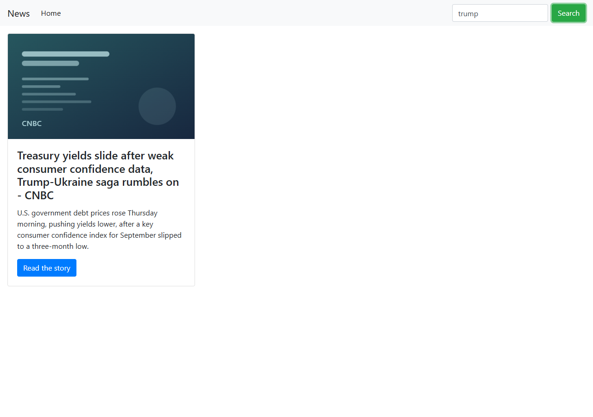
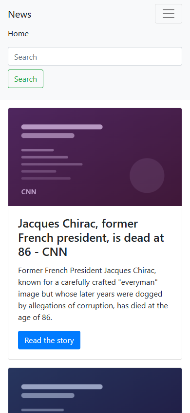

# News

**[▶ Live demo](https://dimitriuses.github.io/News-React/)**

[](https://github.com/Dimitriuses/News-React/actions/workflows/pages.yml)
[](https://reactjs.org/)
[](LICENSE)

A news reader built over five days in September 2019, while I was learning React: a card
grid of headlines with a search box, fetched from [newsapi.org](https://newsapi.org). It is
a learning project and it is archived — the code is here as it was written, tidied enough
to build and run on a current toolchain.


## Status and history

Five commits between 26 and 30 September 2019 — `Initial commit from Create React App`,
`add header`, `go to first error`, `fix bags`, `add using API` — and then nothing for seven
years apart from Dependabot. Three of the four working commits landed on the first day.

**It still ran, unmodified, in 2026.** Before anything here was changed, the 2019 tree was
installed and started on Node 22: it compiled and rendered nineteen live articles from
newsapi.org. That is unusual for this vintage and worth saying plainly. What it did *not*
do was work correctly — see *Known limitations*.

The commit `go to first error` is the honest one. It added 272 lines in a single step —
the whole card grid, the search box, the list — which is how the app ended up with a search
feature that had never once been run.

### The API key

`src/APIClient.js` carried a newsapi.org key hardcoded into the URL, committed on
2019-09-30. Checked on 2026-07-30, it still returned a `200` with live data: it had been
public for nearly seven years.

It has been removed from the source. **It has not been revoked**, and I would rather say so
plainly than write a tidier sentence. The account was registered to an email address I no
longer control — most likely a throwaway used to get a key quickly in 2019 — and
newsapi.org does not recognise it, so I cannot log in to disable the key. Asking their
support to disable it is the only route left, and until that happens the key is live.

Worth being precise about what that is and is not. It is a free-tier key for an API that
serves public news headlines. There is no billing attached to it, no personal data behind
it, and it is not a password: the worst it can do is spend a daily request quota on an
account I no longer have. It should never have been committed, and the reason it is
discussed here at length is that *not* noticing it for seven years is the actual mistake.

It is still in the git history and in the `v0.1-original` tag, deliberately. Rewriting
history would not undo the exposure — the repository has been public the entire time, and
the key is in eleven Dependabot branches as well — it would destroy the preserved original,
and it would produce the *appearance* of a fix without being one.

The app now serves **twelve headlines from 26 September 2019**
(`src/newsSnapshot.js`). Those are not invented for the demo — they are the sample articles
the 2019 code kept in `App.js`'s initial state, which stopped being read the moment the app
switched to the live API and sat there as dead code ever since. Supply your own key to
fetch live news again.

## What the 2026 tidy changed

No feature was added. The list below is repairs and deletions.

| | Then | Now |
|---|---|---|
| Build warnings | 12 | **0** |
| Third-party hosts requested | 23 | **0** |
| Horizontal overflow on a 390px phone | 186px | **0px** |
| Clicking *Search* | throws, then reloads the page | filters the list |
| Nav links that render a blank page | 2 of 5 | **0** |
| `console.log` in hand-written code | 9 | **0** |
| Commented-out code | 30 lines | **0** |
| Resolved npm packages | 1328 | 1323 |

| Searching, without a page reload | On a 390px phone |
|---|---|
|  |  |

- **Search is wired up.** `Header` was declared `const Header = (onSearch) => …`, so its
  parameter was really the whole props object — and `App` rendered `<Header/>` with no
  props at all. The search box therefore received `onSearch={{}}` and threw
  `TypeError: this.props.onSearch is not a function` on every click. Separately, its button
  was `type="submit"` inside a `<form>` with no `onSubmit`, so the same click also triggered
  a native form submission and reloaded the page. Both are fixed.
- **The grid lays out.** Masonry was loaded from a CDN with a `data-masonry` attribute,
  which makes it initialise on `DOMContentLoaded` — before React had rendered a card. It
  measured an empty container, set its height to `0`, and never ran again, so every card
  fell out of a zero-height grid into a single column on the left. Replaced with a CSS
  `column-count` layout, which needs no JavaScript and reflows on a phone.
- **Seven CDN `<script>` tags removed**, plus the inline one that called into them. Apart
  from Masonry — which did something, just nothing good — none of them had any effect at
  all: jQuery 1.11.1 was overwritten by jQuery 3.2.1 *slim* four lines later;
  `$('body').bootstrapMaterialDesign()` ran in `<head>`, where `$('body')` matches nothing,
  so the DOM held 0 `bmd-` markers; Bootstrap's dropdown threw
  `Bootstrap dropdown require Popper.js` on every page load because Popper was loaded after
  it; SnackbarJS was loaded and never referenced from any source file. Bootstrap 4 is an npm
  dependency now, so the page makes no third-party requests at all.
- **Dead code deleted.** `NewsItem` carried `btnChange`, `btnText`, `favorite`,
  `onBtnClick`, `onFavorivteClick` and a `btnStar` class name — a favourites feature that
  was never attached to an element, so no star was ever rendered. `remapList`,
  `updateNews`'s ignored `country` parameter, the commented-out Create React App
  boilerplate, `App.css` and `logo.svg` are gone too.
- **The dead nav links are gone.** *About* and *Add New* routed to pages that were never
  written and rendered a blank body under the navbar; *Pricing* and *Disabled* were
  `href="#"`. Only *Home* did anything.
- **The hotlinked news photographs are gone**, replaced by generated placeholders. See
  [NOTICE.md](NOTICE.md).

The original is preserved at the `v0.1-original` tag. Nothing in the 2019 history has been
rewritten.

## Running it

Needs Node 22 (see `.nvmrc`). `react-scripts` 3.1.2 is webpack 4, which hashes with md4;
OpenSSL 3 removed md4, so **both** `npm start` and `npm run build` need a flag:

```bash
npm ci

# bash
NODE_OPTIONS=--openssl-legacy-provider npm start

# PowerShell
$env:NODE_OPTIONS="--openssl-legacy-provider"; npm start
```

Then open <http://localhost:3000>.

To fetch live headlines instead of the 2019 snapshot, get a key from
[newsapi.org](https://newsapi.org) and pass it to `loadNews` in `src/App.js`:

```js
loadNews("your-key-here", "us")
```

## Tests

The single Create React App smoke test, which is all this project ever had:

```bash
CI=true NODE_OPTIONS=--openssl-legacy-provider npm test -- --watchAll=false
# Tests: 1 passed, 1 total
```

It passes — and it passes on the 2019 code too, which was checked before anything was
changed. That is not much of a compliment: it asserts nothing beyond "renders without
throwing", so it would not have caught a single defect described above.

## Layout

```
src/
  App.js                    state, search filter, and where the headlines come from
  APIClient.js              the 2019 newsapi.org client, minus the key
  newsSnapshot.js           the twelve 2019 articles (generated - see tools/)
  Components/
    Header/                 navbar, hosts the search box
    Search/                 the search form
    NewsList/               the column grid
    NewsItem/               one card
tools/
  build-snapshot.js         builds newsSnapshot.js and the placeholder SVGs
  seed-2019.json            the seed articles, extracted from v0.1-original
public/news/                generated placeholder images
```

## Known limitations

Real ones, all measured rather than guessed:

- **No live data by default.** The demo is a fixed snapshot of twelve articles from one day
  in 2019. Search filters those twelve and nothing else.
- **Search matches titles only**, by case-insensitive substring, and only when you submit —
  there is no debounce and no live filtering. An empty result gets one line of text.
- **One route.** The router is a `BrowserRouter` with a single `/` route. It was carrying
  five nav links to routes that mostly did not exist; those are gone rather than built.
- **No error handling worth the name.** A failed fetch renders a one-line Bootstrap alert.
  The 2019 version threw `new Error("Cannot data")`, which is at least memorable.
- **No tests to speak of** — one smoke test that asserts nothing. Adding a real suite was
  out of scope for this pass, and I would rather say so than ship a token test file.
- **`npm audit` reports 225 advisories** (23 critical). Every one is in the webpack, Babel,
  ESLint or Jest toolchain that `react-scripts` 3.1.2 pins; **none names a package that
  reaches the browser bundle** — checked against `react`, `react-dom`, `react-router-dom`
  and `bootstrap`. Upgrading would mean replacing Create React App, which would make this
  something other than a 2019 artifact.
- **The class components are period-typical, not idiomatic.** Hooks existed by then and
  this code mostly does not use them. That is what the project looked like, and rewriting
  it would be dishonest about what I knew in 2019.

## Licence

MIT — see [LICENSE](LICENSE). Third-party notices are in [NOTICE.md](NOTICE.md).
